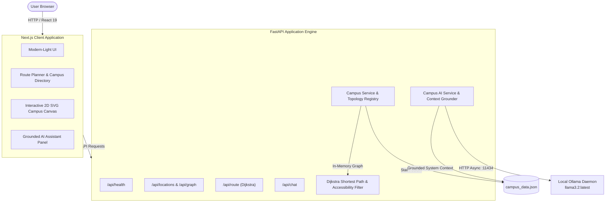

# RouteCraft AI — Intelligent Campus Navigator & Accessibility-Aware Router

[](LICENSE)
[](https://www.python.org/)
[](https://fastapi.tiangolo.com/)
[](https://nextjs.org/)
[](https://tailwindcss.com/)
[-orange.svg)](https://ollama.com/)

> **Prototype Demonstration Notice**: All building layouts, path lengths, and accessibility features depicted in RouteCraft AI are currently based on a synthetic demonstration dataset for Aurora University. Real-world physical navigation on Aurora campus has not been certified and requires official field surveying.

---

## 📌 Problem Statement

Navigating complex university campuses presents significant daily friction for new students, visitors, and individuals with mobility impairments. Existing commercial map providers frequently lack granular pedestrian walkways, indoor facility context, stair alerts, and verified wheelchair-accessible ramps. Furthermore, cloud-dependent navigational assistants raise serious data privacy concerns and require costly API subscriptions.

**RouteCraft AI** solves these challenges by combining:
1. **Mathematical Precision**: Shortest-path pedestrian routing using **Dijkstra's Algorithm** with priority queues.
2. **Accessibility-Aware Routing**: Adaptive preferences for **Shortest Route**, **Wheelchair-Friendly Route** (requiring verified barrier-free ramps), and **Avoid Stairs** (bypassing physical staircases).
3. **100% Private, Grounded Local AI**: A conversational assistant powered by **Ollama (`llama3.2:latest`)** that runs strictly on your machine, answers strictly from campus dataset knowledge, and refuses to hallucinate unrecorded facilities.
4. **Zero Cloud Subscriptions**: Operates fully offline without paid Google Cloud, OpenAI, or Anthropic API keys.

---

## ✨ Features

- **🧭 Dijkstra Routing Engine**: Computes optimal walking paths, total distance in meters, estimated walking duration, and sequential turn-by-turn walking instructions.
- **♿ Accessibility-Aware Navigation**:
  - **Shortest Route**: Direct shortest path across all campus walkways.
  - **Wheelchair-Friendly Route**: Strictly traverses pathways with verified accessibility surveys and ramp-equipped stairs, excluding unramped steps and unverified trails.
  - **Avoid Stairs**: Bypasses physical staircases and stepped corridors, routing through level walkways or accessible ramps.
- **🛡️ Conservative Accessibility Guardrails**: Never claims a pathway is accessible unless its physical survey status has been verified (`accessibility_verified: true`).
- **🗺️ Interactive 2D Schematic Canvas**: Smooth pan-and-zoom SVG map with live directional edge flow (`animate-route-flow`), landmark highlighting (Start = Emerald, Destination = Red, Waypoints = Blue), and interactive selection.
- **🤖 Grounded Local Assistant (Ollama)**: Answers student questions regarding building floors, study rooms, dining commons, and walking directions using local model inference (`llama3.2:latest`).
- **🔌 Offline Fallback Mode**: Automatically detects when the local Ollama daemon is unavailable and gracefully transitions to keyword-based knowledge lookup without crashing.
- **🔍 Instant Campus Search & Category Filtering**: Filter buildings by academic department, dining halls, recreation centers, or tags (e.g., `#quiet`, `#wifi`, `#food`, `#robotics`).

---

## 🏗️ System Architecture



---

## 💻 Technology Stack

| Layer | Technologies |
| :--- | :--- |
| **Frontend Framework** | [Next.js 16](https://nextjs.org/) (App Router), [React 19](https://react.dev/), [TypeScript 5](https://www.typescriptlang.org/) |
| **Styling & Icons** | [Tailwind CSS v4](https://tailwindcss.com/), [Lucide React](https://lucide.dev/) |
| **Backend Framework** | [FastAPI](https://fastapi.tiangolo.com/), [Uvicorn](https://www.uvicorn.org/) (ASGI Server), Python 3.10+ / 3.14 |
| **Data Validation** | [Pydantic V2](https://docs.pydantic.dev/) |
| **Routing Algorithm** | Dijkstra Shortest Path with Priority Queues (`heapq`) |
| **Local LLM Engine** | [Ollama](https://ollama.com/) running `llama3.2:latest` |
| **HTTP Client** | [HTTPX](https://www.python-httpx.org/) (Async) |
| **Test Suites** | [Pytest](https://docs.pytest.org/), AnyIO, Custom E2E Verifiers |

---

## 📦 Repository Structure

```text
rootcraft_niat/
├── backend/
│   ├── app/
│   │   ├── data/
│   │   │   └── campus_data.json       # Aurora University annotated dataset
│   │   ├── models/
│   │   │   └── schemas.py             # Pydantic schemas (Nodes, Edges, Routes)
│   │   ├── routing/
│   │   │   └── dijkstra.py            # Accessibility-aware Dijkstra algorithm
│   │   ├── services/
│   │   │   ├── campus_service.py      # Campus data store & lookup
│   │   │   └── ai_service.py          # Grounded Ollama assistant & fallback
│   │   ├── routers/
│   │   │   ├── health.py              # /api/health
│   │   │   ├── locations.py           # /api/locations, /api/graph, /api/categories
│   │   │   ├── routes.py              # /api/route (POST & GET)
│   │   │   └── chat.py                # /api/chat
│   │   ├── config.py                  # Environment config & CORS
│   │   └── main.py                    # FastAPI entrypoint
│   ├── scripts/
│   │   └── run_stage5_e2e_verification.py # 10-point E2E verification suite
│   ├── tests/
│   │   ├── test_routing.py            # Dijkstra unit tests (Normal, Stairs, Wheelchair)
│   │   └── test_api.py                # Integration tests for all endpoints
│   ├── pytest.ini
│   └── requirements.txt
├── frontend/
│   ├── app/
│   │   ├── globals.css                # Tailwind base styles & keyframes
│   │   ├── layout.tsx                 # Root layout with system font stack
│   │   └── page.tsx                   # Main interactive campus navigation page
│   ├── components/
│   │   ├── Header.tsx                 # Top bar, status pills & demo disclaimer
│   │   ├── Sidebar.tsx                # Route planner, preference selector & directory
│   │   ├── CampusMap.tsx              # Interactive SVG map & rationale callout
│   │   └── AIAssistantPanel.tsx       # Collapsible grounded AI assistant panel
│   ├── services/
│   │   └── api.ts                     # Type-safe frontend API client
│   ├── types/
│   │   └── campus.ts                  # TypeScript interfaces
│   ├── package.json
│   └── tsconfig.json
├── .gitignore
├── LICENSE                            # MIT License
└── README.md
```

---

## ⚡ Prerequisites

Before running the application locally on Windows, ensure the following are installed:

1. **Python 3.10+** (Tested on Python 3.14): [python.org](https://www.python.org/downloads/)
2. **Node.js 20+ LTS** (or Node.js 22): [nodejs.org](https://nodejs.org/)
3. **Ollama**: [ollama.com](https://ollama.com/download)
4. **Git**: [git-scm.com](https://git-scm.com/)

---

## 🚀 Setup Instructions (Windows PowerShell)

### Step 1: Clone or Open the Repository
```powershell
cd rootcraft_niat
```

### Step 2: Configure and Start Local Ollama
1. Open PowerShell and pull the lightweight LLaMA 3.2 model:
   ```powershell
   ollama pull llama3.2
   ```
2. Verify that the model is loaded:
   ```powershell
   ollama list
   ```
   *(Ensure Ollama is running in your system tray or run `ollama serve`).*

### Step 3: Backend Setup
Open a PowerShell terminal for the backend:

```powershell
# 1. Navigate to the backend directory
cd backend

# 2. Create Python virtual environment
py -m venv venv

# 3. Activate virtual environment
.\venv\Scripts\Activate.ps1

# 4. Install dependencies
pip install -r requirements.txt

# 5. Run test suite to verify setup
python -m pytest tests -v

# 6. Start the FastAPI development server
uvicorn app.main:app --reload --host 127.0.0.1 --port 8000
```
The backend API is now running at `http://127.0.0.1:8000`.
- **Interactive Swagger Docs**: `http://127.0.0.1:8000/docs`
- **ReDoc Documentation**: `http://127.0.0.1:8000/redoc`

### Step 4: Frontend Setup
Open a second PowerShell terminal in the repository root:

```powershell
# 1. Navigate to the frontend directory
cd frontend

# 2. Install dependencies
npm install

# 3. Start the Next.js development server
npm run dev
```
Open **[http://localhost:3000](http://localhost:3000)** in your browser.

---

## ⚙️ Environment Variables

RouteCraft AI runs with sensible local defaults out of the box. You may customize any setting via environment variables:

| Variable | Default Value | Description |
| :--- | :--- | :--- |
| `OLLAMA_BASE_URL` | `http://127.0.0.1:11434` | Base URL of the local Ollama daemon service |
| `OLLAMA_MODEL` | `llama3.2:latest` | Target LLM model name for grounded chat |
| `OLLAMA_TIMEOUT_SECONDS` | `90.0` | Timeout threshold in seconds for LLM responses |
| `CAMPUS_DATA_PATH` | `app/data/campus_data.json` | Path to the JSON campus dataset |
| `NEXT_PUBLIC_API_URL` | `http://127.0.0.1:8000/api` | API base URL consumed by the Next.js frontend |

To override an environment variable in PowerShell prior to launching:
```powershell
$env:OLLAMA_MODEL = "llama3.2:latest"
$env:OLLAMA_TIMEOUT_SECONDS = "60.0"
```

---

## 📡 API Reference

### 1. Health & System
- **`GET /api/health`**
  - **Response (200 OK)**:
    ```json
    {
      "status": "healthy",
      "campus_data_loaded": true,
      "total_locations": 11,
      "total_connections": 20,
      "is_demo_data": true,
      "ollama_status": "ready",
      "ollama_model": "llama3.2:latest"
    }
    ```

### 2. Locations & Topology
- **`GET /api/locations`**: List all campus locations.
  - Query parameters: `?q=library` (search), `?category=Academic%20%26%20Research` (filter).
- **`GET /api/locations/{location_id}`**: Get single building by ID (e.g. `/api/locations/lib`).
- **`GET /api/categories`**: List distinct categories.
- **`GET /api/graph`**: Full graph containing nodes, coordinates, and pathway edges with `has_stairs`, `ramp_available`, and `accessibility_verified`.

### 3. Route Calculation (Dijkstra)
- **`POST /api/route`**
  - **Payload**:
    ```json
    {
      "start_id": "sci",
      "destination_id": "eng",
      "preference": "wheelchair"
    }
    ```
  - **Supported preferences**: `"shortest"`, `"wheelchair"`, `"avoid_stairs"`.
  - **Response (200 OK)**:
    ```json
    {
      "found": true,
      "start_id": "sci",
      "destination_id": "eng",
      "preference": "wheelchair",
      "total_distance": 650.0,
      "distance_unit": "meters",
      "path_node_ids": ["sci", "lib", "quad", "eng"],
      "preference_explanation": "Wheelchair-accessible route utilizing only surveyed barrier-free pathways and verified ramps (avoids unramped stairs and unverified trails).",
      "is_accessible_verified": true,
      "steps": [
        {
          "step_number": 1,
          "from_node_id": "sci",
          "from_node_name": "Science & Discovery Complex",
          "to_node_id": "lib",
          "to_node_name": "Phillips Central Library",
          "distance": 230.0,
          "cumulative_distance": 230.0,
          "instruction": "Depart from Science & Discovery Complex along the West-central pedestrian path towards Phillips Central Library (230 meters).",
          "path_type": "West-central pedestrian path",
          "has_stairs": false,
          "ramp_available": true,
          "accessibility_verified": true
        }
      ]
    }
    ```
- **`GET /api/route?start_id=sci&destination_id=eng&preference=avoid_stairs`**
  - Same response format via standard GET query parameters.

### 4. Grounded Campus AI Assistant
- **`POST /api/chat`**
  - **Payload**:
    ```json
    {
      "message": "Where is Phillips Central Library and what study facilities does it have?",
      "current_location_id": "north_gate"
    }
    ```
  - **Response (200 OK)**:
    ```json
    {
      "reply": "The Phillips Central Library (ID: lib) is located on Floors 1-4. It features quiet research zones, collaborative study pods, digital archives, and a 24/7 IT helpdesk on Floor 1. Please note this information is based on a demonstration prototype for Aurora University.",
      "model": "llama3.2:latest",
      "grounded_in_campus_data": true,
      "ollama_online": true,
      "suggestions": [
        "Where can I find a quiet place to study?",
        "What dining options are available on campus?",
        "How far is the walk from North Gate to the Library?"
      ]
    }
    ```

---

## 🧪 Testing Instructions

### 1. Run Complete Backend Unit & Integration Tests (24 Tests)
Run pytest inside the virtual environment:
```powershell
python -m pytest backend/tests -v
```

### 2. Run Comprehensive Stage 5 & 7 End-to-End Verification
```powershell
python backend/scripts/run_stage5_e2e_verification.py
```
This tests all 10 core requirements:
- Health endpoint status
- Campus locations and topology loading
- Search and category filtering
- Dijkstra shortest path routing
- Accessibility preferences (Shortest vs. Avoid Stairs vs. Wheelchair)
- Inaccessible routes and safe failure handling
- Ollama grounded responses & hallucination guardrails
- Ollama offline fallback behavior
- Demo data notice presence
- Production build artifact verification

### 3. Verify Frontend Production Build
```powershell
cd frontend
npm run build
```

---

## 📷 Screenshots Checklist

When submitting or showcasing RouteCraft AI, capture the following UI states:

- [ ] **1. Campus Overview & Map Canvas**: Full interactive 2D schematic layout displaying all 11 buildings and the demo disclaimer header.
- [ ] **2. Standard Shortest Route**: Route Finder calculating North Gate to South Gate (`720m`) with turn-by-turn directions.
- [ ] **3. Accessibility-Aware Wheelchair Route**: Selecting `Science & Discovery Complex` to `Turing Engineering Hall` with the `Wheelchair` preference active, showing the barrier-free detour (`650m`) around unramped stairs and the `"Verified Barrier-Free"` badge.
- [ ] **4. Stair Avoidance Route**: Showing the `Avoid Stairs` preference routing around physical steps with step badges.
- [ ] **5. Inaccessible Route Error Notice**: Informative alert displayed when a destination cannot be reached under the active preference constraints.
- [ ] **6. Grounded Campus AI Assistant**: Chat panel showing Ollama answering building inquiries based on dataset knowledge.
- [ ] **7. Grounding Guardrail Rejection**: Chat panel showing Ollama rejecting a non-existent building inquiry (*"Hogwarts Hall"*).
- [ ] **8. Offline Fallback State**: Header and AI Assistant reflecting offline Ollama status and displaying keyword-grounded fallback answers.

---

## ⚠️ Known Limitations

1. **Synthetic Demo Dataset**: Building coordinates, path lengths, and accessibility markings are designed for demonstration and educational prototyping. They do not reflect certified architectural surveys of physical Aurora University facilities.
2. **Indoor & Elevator Navigation**: The current graph is a 2D pedestrian exterior network. Multi-floor indoor elevator dispatching and interior corridor routing are planned for future phases.
3. **Local LLM Performance**: Response speed of the Ollama assistant depends on host hardware (CPU/GPU). On machines without dedicated GPUs, responses with `llama3.2:latest` may take 5–15 seconds.

---

## 🤝 Contribution Guidelines

1. **Fork the Repository** and create your feature branch:
   ```bash
   git checkout -b feature/accessibility-indoor-routing
   ```
2. **Follow Code Standards**:
   - Backend: Python PEP 8 compliance, explicit type annotations, Pydantic V2 schemas.
   - Frontend: ESLint, TypeScript strict mode, Tailwind CSS utility classes.
3. **Verify Tests Pass**:
   Ensure all 24 pytest tests and `npm run build` pass before submitting PRs:
   ```powershell
   python -m pytest backend/tests -v
   cd frontend; npm run build
   ```
4. **Submit a Pull Request** with a detailed summary of changes and test results.

---

## 📄 License

This project is licensed under the **MIT License**. See the [LICENSE](LICENSE) file for complete details. All third-party libraries utilized are commercially permissive (MIT, BSD, ISC, Apache 2.0).
